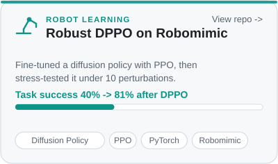
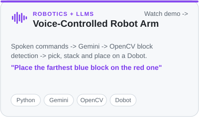
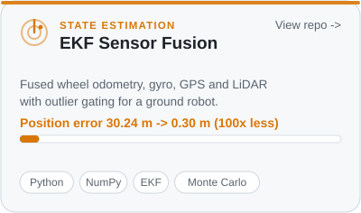
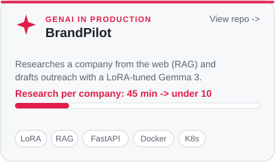
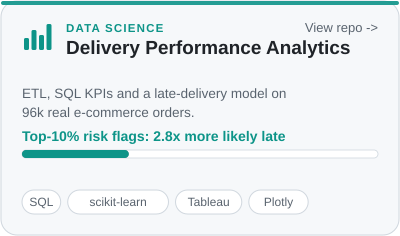
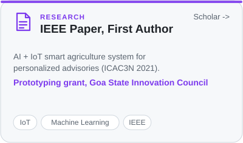
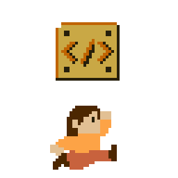

  <picture>
    <source media="(prefers-color-scheme: dark)" srcset="assets/hero-dark.svg">
    <source media="(prefers-color-scheme: light)" srcset="assets/hero-light.svg">
    
  </picture>

  Thanks for stopping by! I build robots and AI systems that leave the notebook and do real work. 
  Take a look around, and feel free to reach out.

  <picture>
    <source media="(prefers-color-scheme: dark)" srcset="assets/about-dark.svg">
    <source media="(prefers-color-scheme: light)" srcset="assets/about-light.svg">
    
  </picture>
  <picture>
    <source media="(prefers-color-scheme: dark)" srcset="assets/stats-dark.svg">
    <source media="(prefers-color-scheme: light)" srcset="assets/stats-light.svg">
    
  </picture>

<h3 align="center">Things I've built</h3>

  <a href="https://github.com/Amatya27/robust-dppo-square"><picture>
      <source media="(prefers-color-scheme: dark)" srcset="assets/card-dppo-dark.svg">
      <source media="(prefers-color-scheme: light)" srcset="assets/card-dppo-light.svg">
      
    </picture></a>
  <a href="https://github.com/Amatya27/voice-controlled-dobot"><picture>
      <source media="(prefers-color-scheme: dark)" srcset="assets/card-voice-arm-dark.svg">
      <source media="(prefers-color-scheme: light)" srcset="assets/card-voice-arm-light.svg">
      
    </picture></a>
  <a href="https://github.com/Amatya27/ekf-sensor-fusion"><picture>
      <source media="(prefers-color-scheme: dark)" srcset="assets/card-ekf-dark.svg">
      <source media="(prefers-color-scheme: light)" srcset="assets/card-ekf-light.svg">
      
    </picture></a>
  <a href="https://github.com/Amatya27/BrandPilot"><picture>
      <source media="(prefers-color-scheme: dark)" srcset="assets/card-brandpilot-dark.svg">
      <source media="(prefers-color-scheme: light)" srcset="assets/card-brandpilot-light.svg">
      
    </picture></a>
  <a href="https://github.com/Amatya27/delivery-performance-analytics"><picture>
      <source media="(prefers-color-scheme: dark)" srcset="assets/card-delivery-dark.svg">
      <source media="(prefers-color-scheme: light)" srcset="assets/card-delivery-light.svg">
      
    </picture></a>
  <a href="https://scholar.google.com/citations?user=VnXsWT0AAAAJ"><picture>
      <source media="(prefers-color-scheme: dark)" srcset="assets/card-ieee-dark.svg">
      <source media="(prefers-color-scheme: light)" srcset="assets/card-ieee-light.svg">
      
    </picture></a>

  More robot builds: <a href="https://github.com/Amatya27/dobot-maze-solver">maze solver</a> · <a href="https://github.com/Amatya27/dobot-yolo-sorting">YOLO sorting arm</a> · <a href="https://github.com/Amatya27/dobot-tic-tac-toe">tic-tac-toe robot</a>

<h3 align="center">What I work with</h3>

ROBOTICS &amp; AI 
  <picture>
    <source media="(prefers-color-scheme: dark)" srcset="https://skillicons.dev/icons?i=py%2Ccpp%2Cpytorch%2Csklearn%2Copencv%2Cros&theme=dark">
    <source media="(prefers-color-scheme: light)" srcset="https://skillicons.dev/icons?i=py%2Ccpp%2Cpytorch%2Csklearn%2Copencv%2Cros&theme=light">
    
  </picture>

SOFTWARE 
  <picture>
    <source media="(prefers-color-scheme: dark)" srcset="https://skillicons.dev/icons?i=java%2Cspring%2Creact%2Cts%2Cjs%2Cfastapi%2Cflask%2Csqlite&theme=dark">
    <source media="(prefers-color-scheme: light)" srcset="https://skillicons.dev/icons?i=java%2Cspring%2Creact%2Cts%2Cjs%2Cfastapi%2Cflask%2Csqlite&theme=light">
    
  </picture>

SHIPPING IT 
  <picture>
    <source media="(prefers-color-scheme: dark)" srcset="https://skillicons.dev/icons?i=docker%2Ckubernetes%2Cgithubactions%2Cprometheus%2Clinux%2Cgit&theme=dark">
    <source media="(prefers-color-scheme: light)" srcset="https://skillicons.dev/icons?i=docker%2Ckubernetes%2Cgithubactions%2Cprometheus%2Clinux%2Cgit&theme=light">
    
  </picture>

<h3 align="center">Let's connect</h3>

  <a href="https://amatya27.github.io/"><picture><source media="(prefers-color-scheme: dark)" srcset="assets/btn-portfolio-dark.svg"><source media="(prefers-color-scheme: light)" srcset="assets/btn-portfolio-light.svg"></picture></a>
  <a href="https://www.linkedin.com/in/amatya-katyayan"><picture><source media="(prefers-color-scheme: dark)" srcset="assets/btn-linkedin-dark.svg"><source media="(prefers-color-scheme: light)" srcset="assets/btn-linkedin-light.svg"></picture></a>
  <a href="https://scholar.google.com/citations?user=VnXsWT0AAAAJ"><picture><source media="(prefers-color-scheme: dark)" srcset="assets/btn-scholar-dark.svg"><source media="(prefers-color-scheme: light)" srcset="assets/btn-scholar-light.svg"></picture></a>

   
  Stay awesome!

